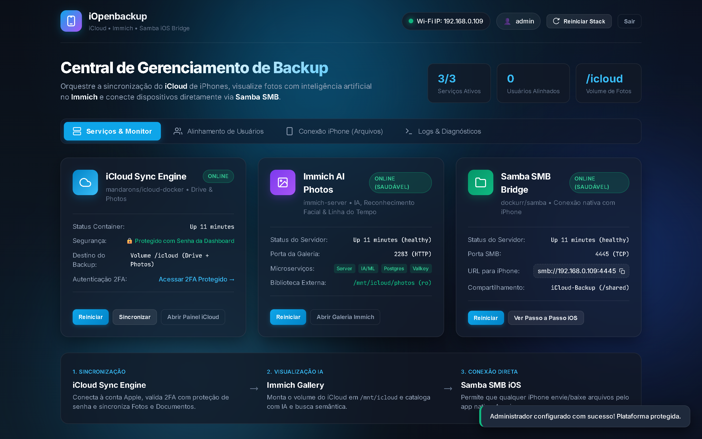
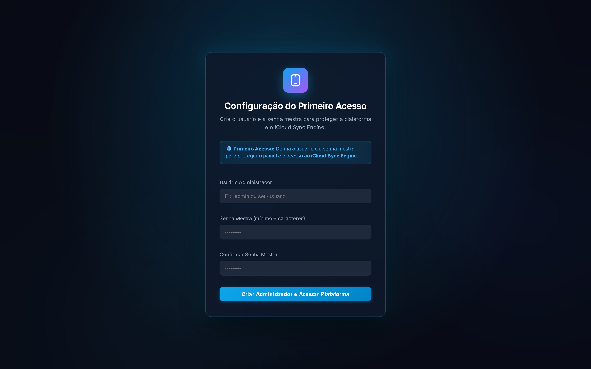
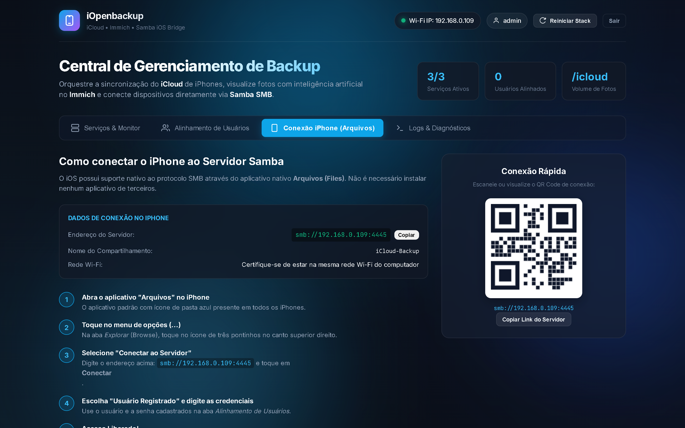
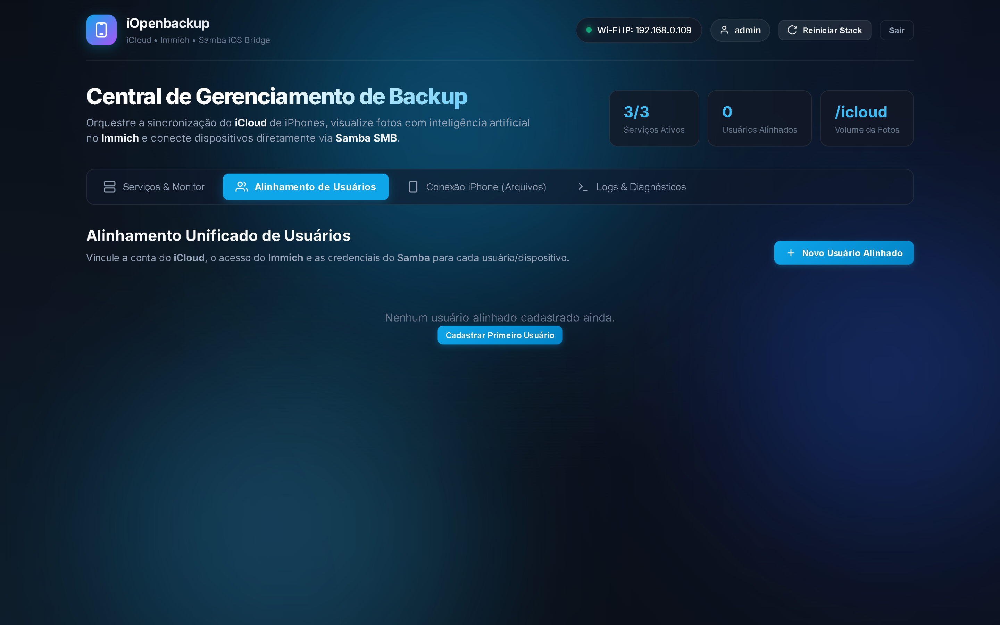

# iOpenbackup

> **Plataforma Aberta e Unificada para Soberania e Backup Automático de iPhones**  
> *Sua nuvem privada, seus dados sob seu controle. Sem limites pagos, sem amarras proprietárias.*

---

## O Manifesto iOpenbackup

Todos os usuários de iPhone enfrentam em algum momento a mesma dor: **o limite de armazenamento esgotado no iCloud**, os avisos insistentes de assinatura mensal e a burocracia cansativa para extrair fotos, vídeos e arquivos originais sem perder qualidade ou metadados.

O **iOpenbackup** nasceu para trazer **liberdade**.

Acreditamos que:
1. **Seus dados pertencem a você:** Suas memórias, fotos em alta resolução e documentos pessoais devem estar guardados em hardware sob o seu controle, na sua casa ou no seu servidor privado.
2. **Simplicidade não deve custar privacidade:** Fazer backup do seu iPhone não precisa ser um pesadelo técnico de comandos manuais. A sincronização deve ser automatizada, a visualização deve ser moderna e a conexão deve ser nativa.
3. **O código aberto liberta:** Esta plataforma é **100% aberta, livre e modificável**. Qualquer pessoa no mundo pode subir esta stack, inspecionar cada linha de código, adaptar para sua realidade e evoluir a ferramenta.

Se você também cansou das barreiras das nuvens proprietárias, o **iOpenbackup** foi feito para você.

---

## Demonstração Visual da Plataforma

<p align="center">
  
</p>

### 1. Primeiro Acesso com Proteção de Senha Mestra & Fundo Azul Pulsante
Interface de primeiro acesso com hash criptográfico PBKDF2 (SHA-512) para proteger o painel e o motor do iCloud:
<p align="center">
  
</p>

### 2. Conexão Nativa do iPhone (App Arquivos / Files)
Instruções integradas para conectar o iPhone via SMB nativo do iOS, com QR Code dinâmico e endereço local:
<p align="center">
  
</p>

### 3. Alinhamento Unificado de Usuários
Central para alinhar contas de Apple ID (iCloud), credenciais do Immich e permissões Samba do iOS:
<p align="center">
  
</p>

---

## Módulos da Stack & Créditos Open Source

O **iOpenbackup** reúne o melhor do ecossistema open-source mundial em uma arquitetura harmoniosa e pronta para produção. Cada módulo desempenha um papel essencial com os devidos créditos aos seus criadores:

| Módulo | Projeto & Criadores | Papel na Plataforma |
| :--- | :--- | :--- |
| **iOpDash (Orquestrador)** | [iOpDash Orchestrator](https://github.com/emersoncassis/iOpenbackup)<br>*(Idealizado por Emerson Carvalho)* | **Módulo Orquestrador Central & Gateway de Segurança:** comanda o ciclo de vida dos containers Docker, provê autenticação por Senha Mestra, atua como proxy reverso blindado para a API do iCloud, unifica contas de usuários e provê telemetria em tempo real. |
| **iCloud Sync Engine** | [mandarons/icloud-docker](https://github.com/mandarons/icloud-docker)<br>*(Criado por Mandar Patil & comunidade)* | Sincronização automatizada contínua com a nuvem Apple: baixa fotos, live photos, álbuns e arquivos do iCloud Drive em segundo plano. |
| **Immich AI Photos** | [immich-app/immich](https://github.com/immich-app/immich)<br>*(Criado por Alex Tran & time Immich)* | Galeria de fotos moderna de alta performance com inteligência artificial, reconhecimento facial, busca semântica, álbuns e linha do tempo. |
| **Samba SMB Server** | [dockurr/samba](https://github.com/dockur/samba)<br>*(Criado pela equipe Dockurr)* | Servidor SMB leve e ágil que viabiliza a conexão direta e nativa do iPhone via app **Arquivos (Files)** sem instalar nada extra no aparelho. |
| **PostgreSQL + VectorChord** | [immich-app/postgres](https://github.com/immich-app/immich) | Banco de dados relacional de alta confiabilidade com suporte a índices vetoriais para buscas inteligentes de imagens via embeddings. |
| **Valkey / Redis** | [valkey-io/valkey](https://github.com/valkey-io/valkey) | Gerenciamento de filas de tarefas assíncronas, transcodificação de vídeos e cache ultrarrápido. |

### Arquitetura Integrada & Orquestração
- **Idealizador & Mantenedor da Stack Unificada:** **Emerson Carvalho** ([@emersoncassis](https://github.com/emersoncassis))
- **Módulo Orquestrador iOpDash:**
  - **Orquestração de Containers & Stack:** Controle de início, parada e reinicialização dos containers da stack via Docker socket (`/var/run/docker.sock`).
  - **Gateway de Autenticação Mestra:** Proteção de primeiro acesso com hash PBKDF2 (SHA-512) e sessões criptográficas para blindar a infraestrutura.
  - **Proxy Reverso Autenticado:** Camada de segurança personalizada para blindar a API do motor iCloud (porta interna em loopback), protegendo acessos externos e requisições 2FA.
  - **Motor de Alinhamento de Usuários:** Mapeamento unificado que amarra credenciais de Apple ID, contas Immich e permissões de compartilhamento Samba em um só fluxo.
  - **Automação & One-Click Scripts:** Scripts de primeiro acesso seguro, reset emergencial de credenciais e inicialização da stack.

---

## O Módulo Orquestrador: iOpDash

O **iOpDash** é o cérebro e o centro de comando do **iOpenbackup**. Ele atua como um serviço orquestrador de primeira classe (`service: iopdash` no `docker-compose.yml`), gerenciando e supervisionando os outros serviços:

1. **Gestão do Ciclo de Vida da Stack:** Através do socket local do Docker (`/var/run/docker.sock`), o iOpDash pode monitorar a integridade, reiniciar serviços individualmente (`docker restart samba`, `docker restart icloud`) ou aplicar comandos em lote diretamente pela interface.
2. **Blindagem do iCloud com Proxy Reverso:** O motor `mandarons/icloud-drive` roda estritamente fechado na porta interna. Nenhuma requisição externa acessa diretamente o motor do iCloud; todo tráfego passa pelo gateway autenticado do iOpDash (`/icloud-proxy/`), garantindo que apenas o administrador autenticado execute aprovações 2FA ou sincronizações forçadas.
3. **Sincronização Multi-Serviço de Usuários:** Ao cadastrar ou alterar um usuário no iOpDash, ele sincroniza o e-mail no arquivo de configuração do iCloud (`config.yaml`), alinha as credenciais da galeria Immich e injeta o usuário no servidor Samba SMB (`samba_users.conf`) para liberar o acesso nativo do iPhone.
4. **Telemetria e Detecção de Rede:** O iOpDash detecta automaticamente o IP da máquina na rede local Wi-Fi e exibe instruções visuais com QR Code e link direto para conectar o iPhone via SMB.

---

## Visão Geral da Arquitetura

```text
 ┌─────────────────────────────────────────────────────────────────────┐
 │                      iOpDash - Módulo Orquestrador                  │
 │        - Orquestração de Containers & Controle de Ciclo de Vida     │
 │        - Gateway de Autenticação & Senha Mestra (PBKDF2 SHA-512)    │
 │        - Proxy Reverso Autenticado para iCloud Sync Engine          │
 │        - Alinhador de Contas: Apple ID + Immich + Samba SMB         │
 │        - Telemetria de CPU/RAM, Logs em Tempo Real & Healthcheck    │
 └──────────────────────────────────┬──────────────────────────────────┘
                                    │ (Orquestra e Monitora)
       ┌────────────────────────────┼────────────────────────────┐
       ▼                            ▼                            ▼
 ┌───────────────────┐    ┌───────────────────┐    ┌───────────────────┐
 │ iCloud Sync Engine│    │ Immich AI Photos  │    │  Samba SMB Bridge │
 │ (mandarons/docker)│    │ (immich-server)   │    │  (samba)          │
 └─────────┬─────────┘    └─────────▲─────────┘    └─────────▲─────────┘
           │                        │                        │
           ▼                        │                        │
    [Volume de Dados] ──────────────┴────────────────────────┘
       /icloud & /shared (Fotos + Documentos sincronizados)
```

---

## Início Rápido (Playbook & 1-Click Deploy)

A plataforma foi arquitetada para subir com o mínimo de esforço humano, seja na sua máquina local ou em qualquer servidor VPS na nuvem (Hostinger, Hetzner, AWS, etc.).

---

### Opção 1: 1-Comando via NPX (Recomendado para Qualquer Sistema)
Com o Node.js instalado, você pode executar o instalador oficial diretamente com um único comando:

```bash
npx iopenbackup
```

> **Comandos úteis do CLI:**
> - `npx iopenbackup` — Inicia o assistente interativo de configuração
> - `npx iopenbackup start` — Inicia os containers e abre o Dashboard
> - `npx iopenbackup stop` — Para os containers
> - `npx iopenbackup status` — Verifica o status dos serviços e IPs
> - `npx iopenbackup reset` — Reseta a senha mestra do administrador

---

### Opção 2: 1-Click Playbook para Linux / VPS (Hostinger, Ubuntu, Debian)
Ideal para rodar em um servidor VPS ou máquina dedicada:

```bash
# 1. Clone o repositório
git clone https://github.com/emersoncassis/iOpenbackup.git
cd iOpenbackup

# 2. Execute o instalador automático
chmod +x deploy.sh
sudo ./deploy.sh
```
> **O que o script faz automaticamente:**
> - Detecta o sistema operacional e instala Docker, Docker Compose e Node.js se necessário.
> - Configura as variáveis e permissões de storage.
> - Sobe todos os 6 containers da stack em segundo plano.
> - Cria o serviço no **systemd** para que o dashboard inicie sozinho caso o servidor reinicie.
> - Exibe o link pronto com o IP público da sua VPS para acessar.

---

### Opção 3: Windows (Local)
Ideal para rodar no seu computador pessoal conectado ao mesmo Wi-Fi do iPhone:

1. Clone o repositório ou baixe o ZIP.
2. Dê duplo clique no script:
   ```cmd
   iniciar-dashboard.bat
   ```
   *Ele inicializará os containers Docker e abrirá o Dashboard imediatamente.*

---

### Opção 4: Provisionamento via Ansible Playbook
Para administradores de sistemas que desejam gerenciar infraestrutura como código:

```bash
ansible-playbook -i "IP_DO_SERVIDOR," playbook.yml -u root
```

---

### Deploy Rápido na Hostinger VPS
Na Hostinger, você pode subir o iOpenbackup em poucos cliques:
1. No painel da Hostinger, crie uma VPS e escolha o template do sistema operacional: **"Ubuntu 22.04 64bit com Docker pré-instalado"**.
2. Acesse a VPS via SSH pelo terminal da Hostinger ou pelo seu terminal:
   ```bash
   ssh root@ip-da-sua-vps
   ```
3. Cole o comando do playbook:
   ```bash
   git clone https://github.com/emersoncassis/iOpenbackup.git && cd iOpenbackup && chmod +x deploy.sh && ./deploy.sh
   ```
4. Pronto! Todos os serviços, volumes e o painel estarão rodando na porta 8000 da sua VPS.

---

### Deploy via Dokploy, Portainer ou Coolify
Ao implantar via painéis automatizados como **Dokploy**:
1. Crie uma aplicação do tipo **Compose** apontando para o repositório oficial:
   `https://github.com/emersoncassis/iOpenbackup.git`
2. Clique em **Deploy**. Os serviços essenciais (iCloud Sync + Samba SMB nativo para iPhone) sobem de forma instantânea em segundos sem travar o Raspberry Pi ou a rede.
3. Se desejar ativar a galeria **Immich AI Photos** no Dokploy:
   - No terminal SSH do servidor, execute o download sequencial seguro das imagens:
     ```bash
     bash pull.sh
     ```
   - No Dokploy, na aba **Environment**, adicione a variável:
     `COMPOSE_PROFILES=immich`
   - Clique em **Deploy** novamente. O Immich iniciará usando as imagens já baixadas sem nenhum timeout.

---

### 3. Configurar o Primeiro Acesso (Segurança)
1. Acesse no navegador: **`http://localhost:8000`** (ou `http://IP-DA-VPS:8000`).
2. Defina o seu **Usuário Administrador** e sua **Senha Mestra**.
3. O painel autenticará você e liberará o controle total dos serviços!

---

## Endereços e Portas

| Serviço | URL Local | Na Rede Wi-Fi / LAN | Segurança |
| :--- | :--- | :--- | :--- | :---: |
| **iOpDash (Orquestrador Central)** | `http://localhost:8000` | `http://<IP-DO-HOST>:8000` | Senha Mestra |
| **iCloud Sync Engine** | `http://localhost:8000/icloud-proxy/` | `http://<IP-DO-HOST>:8000/icloud-proxy/` | Proxy Protegido do iOpDash |
| **Immich Galeria de Fotos** | `http://localhost:2283` | `http://<IP-DO-HOST>:2283` | Usuário Immich |
| **Samba SMB (iPhone)** | `smb://localhost:4445` | `smb://<IP-DO-HOST>:4445` | Usuário Samba |

---

## Conectando o iPhone pelo App Nativo "Arquivos"

Você não precisa de aplicativos proprietários ou adicionais no iOS. O iPhone possui cliente SMB embutido de fábrica:

1. Conecte o iPhone na **mesma rede Wi-Fi** do computador/servidor.
2. Abra o aplicativo nativo **Arquivos (Files)** no iPhone.
3. Na aba **Explorar (Browse)**, toque no menu de três pontinhos **(...)** no canto superior direito.
4. Escolha **"Conectar ao Servidor"**.
5. Digite o endereço do servidor:
   ```text
   smb://<IP-DO-HOST>:4445
   ```
   *(Exemplo: `smb://192.168.0.109:4445` — você pode conferir o IP exato no topo do Dashboard).*
6. Toque em **Conectar**.
7. Selecione **"Usuário Registrado"** e insira as credenciais criadas na aba *Alinhamento de Usuários*.
8. Toque em **Avançar** e a pasta compartilhada `iCloud-Backup` aparecerá diretamente no seu iPhone!

---

## Redundância & Failover Inteligente de Rede (Cabo Ethernet x Wi-Fi)

Para servidores locais, Raspberry Pi ou hosts Dokploy com conexão cabeada e antena Wi-Fi, o **iOpenbackup** inclui um monitor de contingência inteligente (`scripts/wifi-failover.sh`):

- **Cabo Conectado (Normal):** O Wi-Fi permanece **100% desabilitado** (rádio desligado via NetworkManager/rfkill). Isso elimina conflitos de IP duplo, rotas divididas e reduz o consumo e interferência de sinal.
- **Queda de Cabo (Contingência):** Se o cabo for desconectado ou perder sinal de rede, o monitor **ativa o Wi-Fi imediatamente**, conectando à rede sem fio para garantir que você não perca o acesso ao Dokploy e aos seus backups.
- **Retorno do Cabo:** Quando o cabo é reconectado e o sinal estabiliza, o Wi-Fi é automaticamente **desligado novamente**.

### Comandos de Gerenciamento:

```bash
# 1. Instalar e ativar como serviço permanente no sistema (inicia no boot)
sudo bash scripts/wifi-failover.sh install

# 2. Verificar o status em tempo real das interfaces e do serviço
sudo bash scripts/wifi-failover.sh status

# 3. Acompanhar logs ao vivo
sudo journalctl -u iopenbackup-wifi-failover -f

# 4. Remover o serviço (se desejar)
sudo bash scripts/wifi-failover.sh uninstall
```

---

## Recuperação e Reset de Senha Mestra

Se você esquecer a senha mestra da dashboard, não se preocupe: **seus dados e fotos sincronizados nunca são apagados**. 

Basta executar o script de reset:
```powershell
.\reset-senha.bat
```
ou via PowerShell:
```powershell
.\reset-senha.ps1
```
O sistema retornará imediatamente para a tela de **Configuração do Primeiro Acesso**, permitindo criar um novo usuário e senha com um clique.

---

## Como Contribuir e Evoluir a Plataforma

O **iOpenbackup** é um projeto de código aberto mantido para a comunidade. Toda ajuda é muito bem-vinda:

- **Encontrou um bug?** [Abra uma Issue](https://github.com/emersoncassis/iOpenbackup/issues).
- **Tem uma ideia de nova funcionalidade?** Compartilhe nas discussões ou crie uma Issue.
- **Quer contribuir com código?**
  1. Faça um Fork do projeto
  2. Crie uma branch para sua feature (`git checkout -b feature/minha-melhoria`)
  3. Faça o commit das suas alterações (`git commit -m 'Adiciona suporte a sincronização incremental'`)
  4. Envie para o branch (`git push origin feature/minha-melhoria`)
  5. Abra um **Pull Request**

---

## Licença

Distribuído sob a licença **MIT**. Consulte o arquivo `LICENSE` para mais detalhes.

---

<p align="center">
  <b>iOpenbackup</b> — Liberdade, privacidade e soberania para o backup do seu iPhone.<br>
  Construído pela comunidade open-source.
</p>
